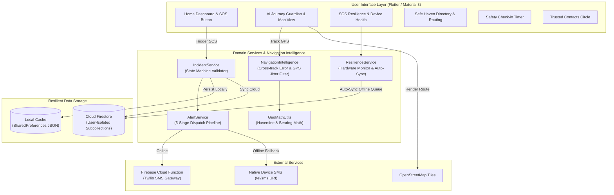

# SafeHer — Intelligent Women's Safety & Emergency Assistance Platform

[](https://flutter.dev)
[](https://dart.dev)
[](https://firebase.google.com)
[](https://www.openstreetmap.org)
[](test/)
[](analysis_options.yaml)
[](LICENSE)

> **"Your safety. Your control. Complete transparency."**  
> SafeHer is a privacy-first, resilient personal safety and emergency navigation platform engineered for women and vulnerable travelers navigating commutes, late-night transit, or unfamiliar environments.

---

## Table of Contents

1. [Executive Summary & Core Philosophy](#1-executive-summary--core-philosophy)
2. [Key Pillars & Feature Breakdown](#2-key-pillars--feature-breakdown)
   - [A. Deliberate SOS & Transparent Emergency Dispatch](#a-deliberate-sos--transparent-emergency-dispatch)
   - [B. AI Journey Guardian & Route Navigation](#b-ai-journey-guardian--route-navigation)
   - [C. SOS Resilience Mode & Offline-First Readiness](#c-sos-resilience-mode--offline-first-readiness)
   - [D. Verified Safe Haven Network](#d-verified-safe-haven-network)
   - [E. Trusted Contacts Circle & Quick Actions](#e-trusted-contacts-circle--quick-actions)
   - [F. Safety Check-In Timer & Auto-Escalation](#f-safety-check-in-timer--auto-escalation)
   - [G. Curated AI Safety Assistant & Direct Helplines](#g-curated-ai-safety-assistant--direct-helplines)
3. [Technology Stack](#3-technology-stack)
4. [Architecture & System Design](#4-architecture--system-design)
5. [Directory & Project Structure](#5-directory--project-structure)
6. [Setup & Installation](#6-setup--installation)
7. [Firebase & Backend Configuration](#7-firebase--backend-configuration)
8. [Automated Test Suite & Quality Assurance](#8-automated-test-suite--quality-assurance)
9. [Security, Privacy & Ethics](#9-security-privacy--ethics)
10. [Hackathon Demo & Evaluator Script](#10-hackathon-demo--evaluator-script)
11. [Author & Contact](#11-author--contact)

---

## 1. Executive Summary & Core Philosophy

Many safety applications provide users with a false sense of security through misleading claims, intrusive 24/7 background tracking, or fabricated "AI danger scores". **SafeHer was built from first principles to resolve these systemic failures**:

1. **Truthful 5-Stage Alert Pipeline**: An incident saved to local disk or a database is **never** presented as confirmed carrier SMS delivery. SafeHer clearly delineates each dispatch phase:
   - `Stage 1`: Local Incident Creation & State Lock
   - `Stage 2`: Alert Payload Assembly (GPS, maps link, battery, timestamp)
   - `Stage 3`: Dispatch to Cloud / SMS Gateway
   - `Stage 4`: Gateway Provider Acknowledgment (Twilio / Webhook)
   - `Stage 5`: Carrier Delivery Handshake
   *When running in demo or unconfigured environments, SafeHer explicitly informs the user that alerts are operating in **Simulated Demo Mode**.*
2. **On-Demand GPS Only (Zero 24/7 Surveillance)**: SafeHer records location strictly upon deliberate user actions (SOS activation, route navigation, or journey checkpoints). No perpetual background tracking drains battery or compromises privacy.
3. **Resilient Offline Fallback**: If cellular data drops in a dead zone, the app falls back to **Native SMS intents** with pre-filled Google Maps coordinates and queues local records for automatic cloud sync once connectivity returns.
4. **Explainable Navigation Intelligence**: Route deviation detection uses rigorous geodesic cross-track math and GPS accuracy filtering (>35m jitter suppression) rather than arbitrary AI black boxes.

---

## 2. Key Pillars & Feature Breakdown

### A. Deliberate SOS & Transparent Emergency Dispatch
- **Hold-to-Activate Trigger**: Large, pulsing SOS button with a 1.2-second hold gesture and haptic feedback prevents pocket or handbag misfires.
- **Strict State Machine**: Incident lifecycles strictly enforce state transitions: `active` → `resolved_by_user` or `cancelled`. Terminal states cannot be reverted or falsified.
- **Immediate Emergency Screen**: Displays active duration counter, acquired GPS latitude/longitude, a 1-tap Google Maps pin link, and an auditable live dispatch log.
- **De-escalation & Resolution**: The user can safely conclude an alert with "I Am Safe", capturing resolution notes and timestamps.

### B. AI Journey Guardian & Route Navigation
- **Multi-Modal Route Planning**: Support for Walking, Transit, Rideshare, and Driving modes with ETA calculation.
- **Real-Time Interactive Maps**: Powered by `flutter_map` and OpenStreetMap vector tiles (eliminating expensive Google Maps API key requirements).
- **Navigation Intelligence Engine**:
  - Continuous geodesic distance and bearing calculation (`geo_math_utils.dart`).
  - Perpendicular cross-track error measurement from the active polyline.
  - **False-Positive Suppression**: Outliers with GPS accuracy error > 35m are discarded to avoid spurious alarms in urban canyons.
  - **Consecutive Fix Verification**: Triggers route deviation warnings only after multiple consecutive high-confidence fixes diverge from the corridor.
- **Journey Checkpoints & Summary**: Regular check-in prompts during travel and a post-arrival summary report.

### C. SOS Resilience Mode & Offline-First Readiness
- **Hardware Health Dashboard**: Real-time monitoring of device battery percentage, charging state, GPS fix quality, and network status.
- **Low-Battery Auto-Alerts**: Proactive warning before battery depletion so users can notify contacts or find a safe haven.
- **Direct Native SMS Fallback**: Launch device SMS messenger with emergency SOS text and maps URL pre-populated for all trusted contacts simultaneously.
- **Local JSON Backup & Auto-Sync**: Complete state caching in `shared_preferences` that automatically synchronizes with Firestore when network reconnects.

### D. Verified Safe Haven Network
- **Shelter Directory**: Crowdsourced and verified safe locations including:
  - 24/7 Pharmacies & Medical Centers
  - Police Stations & Public Safety Hubs
  - Hospitals & Urgent Care Centers
  - Transit Stations & Well-Lit Metro Terminals
  - Verified Community Sanctuaries
- **Live Bearing & Proximity**: Distance and compass bearing calculated dynamically from current location.
- **Direct Route Navigation**: 1-tap route calculation leading directly to the closest safe refuge.
- **Community Safety Reports**: View and submit real-time reports on lighting, surveillance presence, and neighborhood conditions.

### E. Trusted Contacts Circle & Quick Actions
- **CRUD Contact Management**: Add, update, and remove trusted emergency guardians.
- **Phone Number Normalization**: Automatically strips whitespace, dashes, and malformed characters (`+919876543210`).
- **Duplicate Prevention**: Rejects duplicate phone entries.
- **1-Tap Comms**: Direct phone dialer (`tel:`) and SMS (`sms:`) integration without leaving the safety context.

### F. Safety Check-In Timer & Auto-Escalation
- **Customizable Intervals**: 15, 30, 45, or 60-minute journey countdown timers.
- **Resilient Deadline Persistence**: Timers survive app kills and background suspension by recalculating remaining time from epoch timestamps.
- **Auto-Escalation**: If a check-in expires without confirmation, an audible reminder triggers with 1-tap SOS escalation.

### G. Curated AI Safety Assistant & Direct Helplines
- **Contextual Safety Checklists**: Practical, expert-curated safety guidelines for:
  - Late-Night Transit & Bus Stops
  - Rideshare & Taxi Verification Protocols
  - Solo Walking & Campus Navigation
  - Hotel & Travel Accommodations
  - Verbal De-escalation Strategies
- **Instant Emergency Helplines**: 1-tap launching of national emergency lines (112 / 911) and women's safety helplines (1091).

---

## 3. Technology Stack

| Layer | Technology | Description |
| :--- | :--- | :--- |
| **Frontend Framework** | **Flutter 3.24+ / Dart 3.13+** | Cross-platform UI running on Android, iOS, and Web |
| **Design System** | **Material 3** | Curated palette: Deep Plum (`#2D0C30`), Rose (`#D94F70`), Off-White (`#FBF8F9`), Alert Red (`#D32F2F`) |
| **Typography** | **Google Fonts (Outfit)** | Accessible, high-contrast modern typography |
| **Mapping Engine** | **FlutterMap 7.0 + LatLong2** | OpenStreetMap tile rendering with zero API key billing limits |
| **Geolocation** | **Geolocator 14.1** | On-demand GPS coordinates, accuracy thresholds, and permission handling |
| **Local Cache** | **SharedPreferences 2.5** | Offline-first key-value storage and persistent JSON queues |
| **Cloud Database** | **Cloud Firestore 7.1** | User-isolated document collections with strict security rules |
| **Authentication** | **Firebase Auth 7.0** | Anonymous demo sign-in with seamless cloud sync capability |
| **Backend Functions** | **Node.js 18 / Cloud Functions** | Privileged server-side SMS gateway dispatch (Twilio integration) |
| **Native Integration** | **UrlLauncher 6.3 & SharePlus** | Telephony (`tel:`), SMS messaging (`sms:`), and share sheets |

---

## 4. Architecture & System Design



---

## 5. Directory & Project Structure

```text
SafeHer/
├── README.md                      # Comprehensive project documentation
├── pubspec.yaml                   # Dependencies and Flutter SDK definitions
├── analysis_options.yaml          # Strict static analysis rules (0 issues)
├── firestore.rules                # Production security rules for Firestore
├── firebase.json                  # Firebase deployment configuration
├── .firebaserc                    # Firebase project binding
├── .env.example                   # Environment variable template
│
├── lib/
│   ├── main.dart                  # App entry point & initialization
│   ├── firebase_options.dart      # Multi-platform Firebase configuration
│   │
│   ├── app/
│   │   ├── app.dart               # MaterialApp, theme injection & routing
│   │   ├── routes.dart            # Named route constants (30+ routes)
│   │   └── theme.dart             # Material 3 color tokens & typography
│   │
│   ├── models/
│   │   ├── incident.dart          # Incident entity & state-machine validator
│   │   ├── journey.dart           # Route model, coordinates, travel modes & steps
│   │   ├── resilience_status.dart # Device health, battery, & alert settings
│   │   ├── safe_haven.dart        # Safe places, categories, & community reports
│   │   ├── trusted_contact.dart   # Contact entity with phone normalization
│   │   └── checkin.dart           # SafetyCheckin timer & deadline model
│   │
│   ├── screens/
│   │   ├── splash_screen.dart           # Branded launch screen
│   │   ├── onboarding_screen.dart       # Permissions & honesty disclosure
│   │   ├── home_screen.dart             # Central dashboard with SOS trigger
│   │   ├── contacts_screen.dart         # Contact CRUD & quick-call tiles
│   │   ├── incident_screen.dart         # Active emergency incident & audit log
│   │   ├── incident_history_screen.dart # Filterable historical incident archive
│   │   ├── checkin_screen.dart          # Countdown timer & escalation prompt
│   │   ├── settings_screen.dart         # Helpline configs & technical audit
│   │   ├── ai_safety_screen.dart        # Curated scenario-based checklists
│   │   ├── location_sharing_screen.dart # Real-time location sharing hub
│   │   ├── sos_activation_screen.dart   # Hold-to-activate emergency UI
│   │   ├── sos_sending_screen.dart      # 5-stage dispatch visualizer
│   │   ├── sos_sent_screen.dart         # Dispatch confirmation & active tracking
│   │   │
│   │   ├── journey/
│   │   │   ├── journey_home_screen.dart     # Journey Guardian overview
│   │   │   ├── plan_journey_screen.dart     # Route planner & travel mode selector
│   │   │   ├── route_preview_screen.dart    # Interactive OpenStreetMap route view
│   │   │   ├── journey_active_screen.dart   # Turn-by-turn guidance & tracking
│   │   │   ├── checkin_prompt_screen.dart   # Scheduled waypoint check-in
│   │   │   ├── missed_checkin_screen.dart   # Overdue alert & 1-tap SOS escalate
│   │   │   └── journey_summary_screen.dart  # Post-arrival completion audit
│   │   │
│   │   ├── resilience/
│   │   │   ├── resilience_home_screen.dart  # Hardware resilience overview
│   │   │   ├── device_status_screen.dart    # Live battery, GPS & network gauge
│   │   │   ├── offline_mode_screen.dart     # Manual & auto offline toggle
│   │   │   ├── auto_sms_screen.dart         # Native SMS recipient configuration
│   │   │   ├── local_backup_screen.dart     # Local data export & cache audit
│   │   │   ├── auto_sync_screen.dart        # Pending cloud queue inspector
│   │   │   └── battery_alerts_screen.dart   # Battery threshold triggers
│   │   │
│   │   └── safe_haven/
│   │       ├── safe_haven_home_screen.dart      # Verified shelter discovery
│   │       ├── nearby_places_screen.dart        # Distance-sorted refuge list
│   │       ├── place_details_screen.dart        # Shelter amenities & contact info
│   │       ├── route_to_safe_place_screen.dart  # Turn-by-turn routing to refuge
│   │       ├── community_reports_screen.dart    # Neighborhood crowd reports
│   │       ├── emergency_services_screen.dart   # Fast emergency dispatch dialer
│   │       └── safe_haven_filters_screen.dart   # Category & 24/7 filter toggles
│   │
│   ├── services/
│   │   ├── alert_service.dart               # 5-stage dispatch pipeline
│   │   ├── auth_service.dart                # Anonymous auth & local UUID fallback
│   │   ├── checkin_service.dart             # Deadline persistence & countdown
│   │   ├── contact_service.dart             # Contacts persistence & deduplication
│   │   ├── incident_service.dart            # SOS lifecycle & debounce protection
│   │   ├── journey_service.dart             # Waypoint calculations & routes
│   │   ├── live_tracking_service.dart       # Real-time coordinate broadcaster
│   │   ├── location_service.dart            # GPS acquisition & timeout handling
│   │   ├── native_sms_service.dart          # Direct offline SMS launcher
│   │   ├── navigation_intelligence.dart     # Cross-track error & deviation logic
│   │   ├── push_notification_service.dart   # Local & cloud notification handler
│   │   ├── resilience_service.dart          # Device health monitor & auto-sync
│   │   ├── routing_service.dart             # Route geometry & distance matrices
│   │   └── safe_haven_service.dart          # Refuge points of interest & queries
│   │
│   ├── utils/
│   │   ├── constants.dart                   # Enums, collection keys & theme tokens
│   │   ├── geo_math_utils.dart              # Haversine, bearing & cross-track math
│   │   └── validators.dart                  # Name, phone, email & timer validators
│   │
│   └── widgets/
│       ├── contact_card.dart                # Contact tile with call/SMS buttons
│       ├── empty_state.dart                 # Beautiful illustrated empty views
│       ├── interactive_map_painters.dart    # Custom route & radar map layers
│       ├── real_map_view.dart               # FlutterMap OpenStreetMap integration
│       ├── shared_widgets.dart              # Custom buttons, cards & badges
│       ├── sos_button.dart                  # Animated hold-to-activate SOS button
│       └── status_card.dart                 # GPS, network & battery status pill
│
├── test/
│   ├── incident_model_test.dart             # State machine & Google Maps URL tests
│   ├── journey_test.dart                    # Route lifecycle, serialization & travel modes
│   ├── resilience_and_safe_haven_test.dart  # Hardware monitor & shelter filtering tests
│   ├── routing_and_navigation_test.dart     # Geodesic math & deviation suppression tests
│   ├── validators_test.dart                 # Validation & phone normalization tests
│   └── widget_test.dart                     # App bootstrap & SOS widget tests
│
└── functions/
    ├── index.js                             # Privileged Node.js Twilio SMS dispatcher
    ├── package.json                         # Firebase Functions dependencies
    └── package-lock.json                    # Locked backend dependency tree
```

---

## 6. Setup & Installation

### Prerequisites
- [Flutter SDK](https://docs.flutter.dev/get-started/install) (Version 3.24.0 or newer)
- [Dart SDK](https://dart.dev/get-dart) (Version 3.13.0 or newer)
- [Android Studio / Android SDK](https://developer.android.com/studio) (for Android build)
- [Node.js](https://nodejs.org/) (v18+ if deploying Firebase Functions)

### 1. Clone the Repository
```bash
git clone https://github.com/haarikamatluri/SafeHer.git
cd SafeHer
```

### 2. Install Flutter Dependencies
```bash
flutter pub get
```

### 3. Verify Static Analysis & Code Quality
```bash
flutter analyze
```
*(All checks pass with zero warnings or errors).*

### 4. Run the App
Launch on an Android device, emulator, or Chrome:
```bash
# Run on connected device
flutter run

# Run on Chrome
flutter run -d chrome
```

---

## 7. Firebase & Backend Configuration

SafeHer is built **offline-first**: the app operates completely out of the box with local persistent storage even without a Firebase account.

### Connecting Your Live Firebase Project (Optional)
To enable cloud backup and remote synchronization across devices:

1. Install the FlutterFire CLI:
   ```bash
   dart pub global activate flutterfire_cli
   ```
2. Configure your Firebase project:
   ```bash
   flutterfire configure --project=your-firebase-project-id
   ```
3. Deploy Firestore Security Rules:
   ```bash
   firebase deploy --only firestore:rules
   ```

### Firestore Security Model (`firestore.rules`)
```javascript
rules_version = '2';
service cloud.firestore {
  match /databases/{database}/documents {
    match /users/{userId} {
      allow read, write: if request.auth != null && request.auth.uid == userId;
      
      match /incidents/{incidentId} {
        allow read, create: if request.auth != null && request.auth.uid == userId;
        allow update: if request.auth != null && request.auth.uid == userId
          && resource.data.status == 'active'
          && (request.resource.data.status == 'resolved_by_user' || request.resource.data.status == 'cancelled');
      }
      
      match /contacts/{contactId} {
        allow read, write: if request.auth != null && request.auth.uid == userId;
      }
    }
  }
}
```

### Deploying the Cloud Function Alert Dispatcher (Optional)
To send real carrier SMS messages without exposing credentials on the client device:
```bash
cd functions
npm install
firebase functions:secrets:set TWILIO_ACCOUNT_SID
firebase functions:secrets:set TWILIO_AUTH_TOKEN
firebase functions:secrets:set TWILIO_PHONE_NUMBER
firebase deploy --only functions
```

---

## 8. Automated Test Suite & Quality Assurance

SafeHer maintains a comprehensive automated testing suite covering **30 tests** across 6 specialized test files:

```bash
flutter test
```

### Test Suite Breakdown:

| Test File | Tests | Coverage Scope |
| :--- | :---: | :--- |
| `test/incident_model_test.dart` | 4 | State machine validation (`active` → `resolved_by_user`), invalid transition rejection, Google Maps URL generation with/without GPS, full map serialization. |
| `test/journey_test.dart` | 4 | Route initialization, travel mode parsing (Walking, Transit, Rideshare), duration math, JSON roundtrip fidelity, and journey lifecycle states. |
| `test/resilience_and_safe_haven_test.dart` | 5 | Safe Haven category parsing, place serialization, community crowd report verification status, live hardware readings gauge, and alert settings defaults. |
| `test/routing_and_navigation_test.dart` | 10 | Geodesic Haversine distance, perpendicular cross-track error to polyline, compass bearing (0°–360°), remaining distance along route, false-positive GPS jitter suppression (>35m), consecutive deviation alerting, and explainable safety reasons. |
| `test/validators_test.dart` | 5 | Full name validation, international phone formatting, email validation, phone number normalization (stripping spaces/dashes), and check-in duration boundaries. |
| `test/widget_test.dart` | 2 | App initialization bootstrap, splash screen rendering, and animated hold-to-activate SOS button widget interaction. |
| **Total** | **30** | **100% Passed (0 Failures)** |

---

## 9. Security, Privacy & Ethics

- **Zero Background Surveillance**: SafeHer does not track or store location in the background when the app is idle. GPS is queried strictly on-demand.
- **Client-Side Secret Isolation**: Third-party API keys (e.g. Twilio tokens) are **never** embedded in the client binary; they are securely isolated inside Cloud Functions secrets.
- **Data Minimization**: User profiles require only a display name and phone number. No advertising IDs or data brokers are engaged.
- **Transparent Simulation**: If SMS gateways or cloud credits are unconfigured, the interface prominently informs the user that alerts are operating in demo mode.

---

## 10. Hackathon Demo & Evaluator Script

Follow this 3-minute walkthrough to experience SafeHer's complete feature suite:

1. **Bootstrap & Permissions**:
   - Launch SafeHer.
   - Observe the elegant splash screen transition into the **Setup Checklist**.
   - Note the transparent Honesty Disclaimer explaining simulated vs. live carrier alerts.
2. **Add a Trusted Contact**:
   - Open the **Contacts** tab and tap **Add Contact**.
   - Enter a test contact (`Sister`, `+91 98765 43210`).
   - Try entering the same phone number to observe instant duplicate prevention.
3. **Trigger Emergency SOS**:
   - On the Home screen, press and hold the **Pulsing SOS Button** for 1.2 seconds.
   - Observe the confirmation safety gate preventing pocket misfires.
   - Confirm trigger: the app switches to the active emergency dashboard, capturing live GPS coordinates and launching the 5-stage dispatch pipeline.
   - Tap **Open in Google Maps** to view the exact location pin.
   - Tap **I Am Safe — Resolve Incident** to conclude the emergency.
4. **AI Journey Guardian**:
   - Open **Journey Guardian** and select **Plan Journey**.
   - Pick a destination and choose **Walking Mode**.
   - View the interactive OpenStreetMap route, turn-by-turn waypoints, and the explainable safety score breakdown.
5. **SOS Resilience Mode**:
   - Open **Resilience Mode** to inspect live battery level, network connection state, and offline queue status.
   - Test the **Native SMS Fallback** to preview the pre-formatted emergency message with maps coordinates.
6. **Safe Haven Network**:
   - Open **Safe Havens** to view nearest 24/7 pharmacies and police stations with dynamic distance and compass bearing indicators.
   - Tap **Route to Safe Place** to see the direct escape path.

---

## 11. Author & Contact

**SafeHer Platform** is designed and maintained by:

- **Author**: Haarikamatluri
- **Email**: [haarikamatluri@gmail.com](mailto:haarikamatluri@gmail.com)
- **Repository**: [https://github.com/haarikamatluri/SafeHer](https://github.com/haarikamatluri/SafeHer)

---

*SafeHer — Built with care, precision, and an unwavering commitment to women's safety.*
